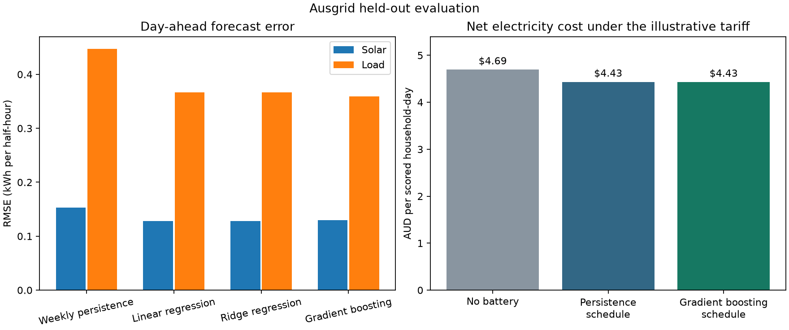
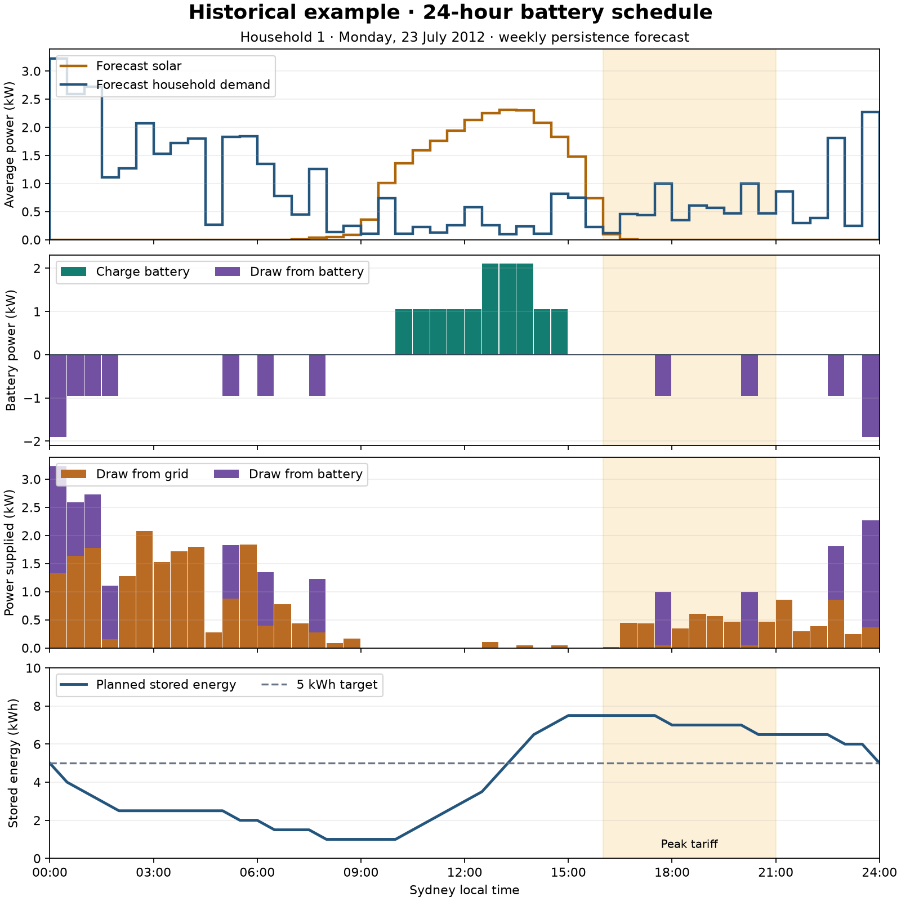

# Can better solar forecasts cut household electricity costs?

**Author**  
Omkar Bhave · UC Berkeley Machine Learning and AI Capstone · Module 24 Final Report

## Executive summary

In a simulation of 300 Australian homes, a battery scheduled with day-ahead forecasts reduced electricity energy charges by **5.6%** compared with no battery. A simpler schedule based on the previous week saved almost as much. The more accurate forecast reduced the simulated cost by only **AUD 0.002 per household-day** compared with that simpler approach, and the uncertainty interval included zero. For a pilot, weekly persistence is a practical starting point.

## Rationale

The homes in this study generated the most solar electricity around noon and used the most electricity around 6 p.m. A battery can store energy for later use. A schedule can help decide when to charge and when to save that energy for hours when electricity costs more.

## Research question

How accurately can we predict tomorrow’s solar generation and household demand in half-hour intervals? Under an illustrative Sydney tariff, does a battery using those predictions reduce energy charges compared with a battery scheduled from the previous week’s readings or a home without a battery?

## What the project delivers

At 6 p.m. Sydney time, the system estimates how much rooftop solar electricity a household will generate and how much electricity it will use in each of the next day’s 48 half-hour periods. Those estimates feed a battery scheduler. For each period, the scheduler recommends charging, supplying the home from the battery, or staying idle. It also reports how much power to move and how much energy the battery is expected to hold afterward.

The study evaluates two decisions separately. First, does the forecasting model improve on simply reusing the previous week’s meter readings? Second, does that improvement lead to lower electricity charges when both forecasting methods use the same battery and tariff?

## Data sources

The study uses 15.64 million half-hour meter readings from 300 Ausgrid homes in New South Wales, from July 2010 through June 2013. The homes had gross solar metering. The [data preparation notes](DATA_PREPARATION.md) describe the data and how to regenerate the processed file. See [Ausgrid attribution](data/sample/ATTRIBUTION.md) for source and license details.

The exploratory analysis found that solar generation exceeded household demand in about **one in five half-hours**. That gap explains why there is a potential role for storage. Typical timing and energy use vary by season and household, so the scheduler uses a separate daily profile for each home. See the [exploratory notebook](notebooks/assignment_20_1.ipynb).

## Methodology

- **Prepare the meter data.** Convert readings to consistent half-hour intervals, combine household demand channels, and check for invalid readings, gaps, and duplicates. Compare forecasts on the same household-days with complete readings and the required history.
- **Compare day-ahead forecasts.** Use the matching half-hour from the previous week as a benchmark. Compare ordinary linear regression, Ridge regression, and gradient boosting using meter history and the calendar. Test parameter combinations on three time-ordered folds, select the model on the following year, and evaluate on the final year.
- **Simulate the battery.** At 6 p.m. Sydney time, plan for the following day. Replay the schedule against actual meter readings as they arrive, respecting the battery’s limits. Compare energy charges on the same days under one illustrative tariff. Account for energy left in the battery so one strategy does not benefit simply by ending with a lower charge.

## Results

### How accurate were the forecasts?

| Forecast measure (kWh per half-hour) | Previous week | Gradient boosting |
| --- | ---: | ---: |
| Solar average absolute error (MAE) | 0.059 | 0.054 |
| Solar error with extra weight on large misses (RMSE) | 0.153 | 0.129 |
| Demand average absolute error (MAE) | 0.225 | 0.207 |
| Demand error with extra weight on large misses (RMSE) | 0.448 | 0.359 |

Gradient boosting reduced errors on both targets compared with the previous week. It improved RMSE by about **15% for solar** and **20% for demand**. During the expensive weekday evening window, demand RMSE fell from 0.526 to 0.418 kWh per half-hour. MAE describes the average size of a miss, while RMSE gives large misses more weight. The models were selected before the final year was scored.

### Did better forecasts lower simulated costs?

The comparison covers the same **106,585 household-days** across all three strategies. Costs are net energy charges after export credits and, for the battery strategies, an adjustment for stored energy.

| Strategy | Total cost (AUD) | Savings versus no battery (AUD) |
| --- | ---: | ---: |
| No battery | 500,225 | — |
| Battery scheduled from the previous week | 472,377 | 27,848 |
| Battery scheduled with gradient boosting | 472,175 | 28,050 |

The battery delivered most of the savings. The estimated extra savings from gradient boosting were **AUD 0.002 per household-day**. To gauge how much that difference might vary, we repeatedly resampled pairs of results in blocks of dates, keeping each strategy on the same households and days. The resulting 95% interval was about **AUD −0.005 to +0.008 per household-day**. It includes zero, so the backtest gives no clear evidence that gradient boosting cuts energy charges further under this tariff. See the [dispatch notebook](notebooks/03_battery_dispatch.ipynb).



### What the schedule looks like

This historical example shows one Ausgrid household on 23 July 2012 using the previous week’s readings. Run the dispatch notebook below to see tomorrow’s Sydney timeline. Above zero means charging, below zero means drawing energy from the battery, and zero means idle. The shaded window is the weekday peak tariff. The power-supplied panel shows scheduled grid imports and battery discharge. Both can occur in the same half-hour. Grid imports can also charge the battery. The last panel shows planned stored energy.



## Scope and limitations

The estimates describe this historical Ausgrid cohort under an illustrative Sydney tariff. The study evaluates energy charges. Battery purchase and installation costs, degradation, and fixed charges were outside the cost calculation, so the savings figures cannot establish payback. Weather forecasts were unavailable for this run. Changes in weather, tariffs, or household usage can affect how a current installation performs.

## Next steps

1. **Pilot the previous-week schedule first.** Generate daily recommendations from current meter readings and actual tariffs before connecting to a physical battery.
2. **Measure the incremental value of the model.** Compare both schedules on the same homes and dates. Track energy charges, peak grid imports, forecast errors, and battery use. Test whether weather forecasts available by 6 p.m. improve the result.
3. **Check the economics before rollout.** Include installation costs, battery wear, and fixed charges in the payback assessment.

## Outline of project

1. [Data preparation and exploratory analysis](notebooks/assignment_20_1.ipynb)
2. [Forecast modeling, cross-validation, and evaluation](notebooks/02_forecast_modeling.ipynb)
3. [Battery dispatch, cost comparison, and uncertainty](notebooks/03_battery_dispatch.ipynb)

### Generate a schedule for a date

Run the schedule cell in the [battery dispatch notebook](notebooks/03_battery_dispatch.ipynb#generate-a-24-hour-schedule) to generate a fresh chart for a Sydney delivery date, household ID, and expected battery energy at midnight. The command below uses the same inputs to export a CSV.

```sh
python src/schedule_day.py 2012-07-23 --household 1 --starting-kwh 5 \
  --meter-csv data/sample/ausgrid_sample.csv --output next-day-schedule.csv
```

The CSV lists forecast solar and demand, the recommended action, signed battery power, and planned stored energy for each half-hour. Positive power charges the battery and negative power supplies the home.

For an upcoming date, pass a current meter CSV in the processed Ausgrid format. The default weekly forecast needs the complete day seven days before delivery. The optional `--forecast validated_model` also needs the complete day two days before delivery and trains using the bundled historical archive by default. The bundled archive covers 2010–2013. When no current meter file is supplied, the notebook displays a clearly labeled illustration using a historical profile on the requested date’s timeline. With a supplied file, it identifies any missing dates. Dates with a daylight-saving clock change are outside the 48-slot implementation.

### Reproduce the results

Use Python 3.14. The full run uses the processed dataset included in the repository. Run these commands from the repository root.

```sh
python3 -m venv .venv
. .venv/bin/activate
python -m pip install -r requirements.txt
OMP_NUM_THREADS=4 OPENBLAS_NUM_THREADS=4 python src/run_capstone.py
python src/plot_capstone.py results/full_implementation.json results/full_implementation.png
python src/plot_schedule.py
```

The [machine-readable results](results/full_implementation.json) include each grid trial, validation and holdout metrics, and the dispatch comparison. The notebooks include saved outputs and can be rerun with Jupyter. For a quick run, use the included two-home sample.

```sh
OMP_NUM_THREADS=4 OPENBLAS_NUM_THREADS=4 python src/run_capstone.py \
  --meter-csv data/sample/ausgrid_sample.csv \
  --validation-start 2012-07-17 --test-start 2012-07-23 \
  --output /tmp/solar-capstone-sample.json
```

## Contact and further information

Omkar Bhave · UC Berkeley Machine Learning and AI Capstone
